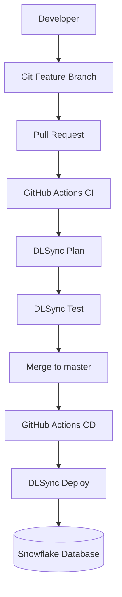

# Snowflake DLSync CI/CD Pipeline

Automated database change management and deployment using **Snowflake DLSync, GitHub Actions, SQL, and Bash**.

## Project Overview

This project demonstrates how to manage Snowflake database changes through a Git-based CI/CD workflow.

Instead of manually executing SQL scripts in Snowflake, database changes are version-controlled, validated through pull requests, and automatically deployed after merging into the main development branch.

### Objectives

- Manage Snowflake database objects as code.
- Track database changes using Git.
- Validate SQL changes before deployment.
- Automate database deployments using GitHub Actions.
- Separate database configuration from SQL scripts.

## Architecture

## Technology Stack

| Technology | Purpose |
|---|---|
| Snowflake | Cloud data platform |
| DLSync | Database change management |
| GitHub Actions | CI/CD automation |
| Git | Version control |
| SQL | Database objects and migrations |
| Bash | Workflow execution scripts |
| Snowflake CLI | Database connectivity and verification |
| GitHub Codespaces | Cloud development environment |

## Database Objects

The pipeline deploys the following objects into `DEMO_DB_DEV.DEMO_SCHEMA`.

| Object | Type | Description |
|---|---|---|
| CUSTOMERS | Table | Stores customer information |
| ORDERS | Table | Stores customer orders |
| CUSTOMER_SUMMARY | View | Aggregates customer order counts and spending |
| CALCULATE_TAX | SQL UDF | Calculates tax using country-specific rates |

## CI/CD Workflow

### Continuous Integration (CI)

Triggered when a pull request targeting `master` contains changes under `db_scripts/`.

1. Check out the repository.
2. Configure Java and download DLSync.
3. Execute DLSync Plan.
4. Publish the deployment plan as a pull request comment.
5. Execute DLSync Test.
6. Publish test output as a pull request comment.

The repository also runs workflow lint checks.

### Continuous Deployment (CD)

Triggered when changes under `db_scripts/` are pushed to `master`. Manual execution is also supported.

1. Check out the repository.
2. Configure Java and download DLSync.
3. Execute DLSync Deploy.
4. Apply database changes to Snowflake.

## Configuration

Development configuration is maintained in:

- `parameter-dev.properties`
- `config.yml`

The GitHub Actions workflows use repository secrets and variables to configure Snowflake connectivity.

**Secrets:** `SNOWFLAKE_ACCOUNT`, `SNOWFLAKE_USERNAME`, `SNOWFLAKE_PASSWORD`, `SNOWFLAKE_ROLE`, `SNOWFLAKE_WAREHOUSE`.

**Variables:** `SNOWFLAKE_DATABASE`, `SNOWFLAKE_SCHEMA`, `PROFILE`.

Credentials must not be committed to the repository.

## Validation Results

The CI/CD workflow was successfully executed using GitHub Actions.

The deployment was verified through Snowflake CLI. The following objects were confirmed in the development schema:

- `CUSTOMERS`
- `ORDERS`
- `CUSTOMER_SUMMARY`
- `CALCULATE_TAX`

The deployment created the database objects without loading sample business records.

## Key Takeaways

This project demonstrates a Git-driven database deployment workflow in which SQL changes are reviewed, validated, and deployed through automated CI/CD pipelines.

It provides practical experience with Snowflake database change management, GitHub Actions, and DevOps practices for data engineering.

## Reference

Based on the [Snowflake DLSync GitHub Actions Quickstart](https://www.snowflake.com/en/developers/guides/devops-dcm-dlsync-github/).